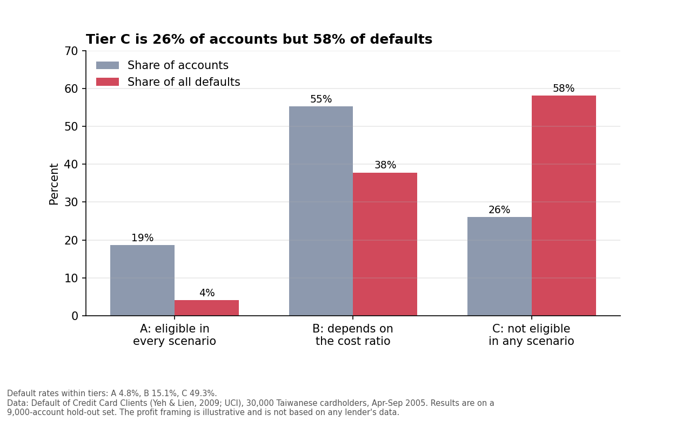

# Credit Card Eligibility Cutoff Strategy: From Default Risk to a Decision

A reproducible workflow that validates a public credit card dataset, builds default-risk models, and
turns the scores into a strategy recommendation: **where should a lender set a risk cutoff, what does each
choice cost, and what would change the answer?**

**This is a personal portfolio project built on public data.** It is not work experience, it does not use
any lender's data, and every profit and cost figure is an illustrative assumption.



## The question and the answer

**Framing (an assumption).** The dataset is existing cardholders, so the realistic decision is account
management, such as who is eligible for a credit limit increase. Suppose an eligible account that stays good
earns 1 unit of profit, and an eligible account that defaults costs **X** units. X is unknown, so every result
is shown for X = 3, 5, 8 and 12. The data cannot show how a limit increase would change behaviour; that part
of the framing is assumed.

**Recommendation (illustrative).** Using the gradient boosting score on 9,000 hold-out accounts:

| Tier | Predicted default probability | Share of accounts | Actual default rate | Share of all defaults | Decision |
|---|---|---|---|---|---|
| A | below 7.7% | 18.6% | 4.8% | 4.1% | Eligible under every cost ratio tested |
| B | 7.7% to 25% | 55.3% | 15.1% | 37.8% | Depends on the cost ratio (a business judgment) |
| C | 25% or more | 26.1% | 49.3% | 58.1% | Not eligible under any cost ratio tested |

For tier B, a simple break-even rule applies: make an account eligible while its predicted default probability
is below 1 / (1 + X). At X = 5 that makes about 57% of all accounts eligible. In all four scenarios this rule
captures 95% to 99% of the best value found by simulation, so it is a reasonable default. The single best
cutoff is uncertain: the value curves are flat near their peaks, and a bootstrap puts the best approval rate
at 41% to 58% for X = 5 and 25% to 40% for X = 8.

**What would change this:** real revenue and loss figures; evidence of how limit increases change behaviour;
and a population that differs from this 2005 Taiwanese sample.

## Data

- **Source:** Yeh, I. (2009). *Default of Credit Card Clients* [Dataset]. UCI Machine Learning Repository.
  https://doi.org/10.24432/C55S3H. Licence: Creative Commons Attribution 4.0 (CC BY 4.0).
- **Content:** 30,000 credit card clients in Taiwan, April to September 2005: credit limit, six months of
  repayment status, bills and payments, and whether the client defaulted the next month.
- **Access:** `src/00_download_data.py` downloads a public CSV copy hosted on GitHub. It is a copy, not the UCI file:
  its row count (30,000), column count (25) and codebook agree with UCI's description, but it was not compared
  value by value. The raw data is not stored in this repository.

## What the pipeline does

| Script | Purpose |
|---|---|
| `src/00_download_data.py` | Download the dataset |
| `src/01_validate.py` | 22 data quality checks on the raw data; writes `reports/qa_summary.md` and `qa_issues.csv` |
| `src/02_clean.py` | Documented cleaning and six behavioural features; writes `reports/cleaning_log.md` |
| `src/03_model.py` | Logistic regression and gradient boosting, validated against one-variable baselines |
| `src/04_strategy.py` | Cutoff simulation, break-even check, bootstrap, tiers and a group screening check |
| `src/05_run_sql.py` | Four SQL queries (`sql/queries.sql`, SQLite) on the scored accounts |
| `src/06_charts.py` | Four charts in `reports/figures/` |
| `src/07_data_dictionary.py` | Data dictionary for the cleaned and scored files; stops with an error if a column is undocumented |
| `src/08_summary_pdf.py` | PDF project summary in `docs/` |

## Key findings

**Data quality** (`reports/qa_summary.md`)
- 30,000 rows, no missing values, no duplicate IDs; default rate 22.12%.
- EDUCATION has 345 rows (codes 0, 5, 6) and MARRIAGE has 54 rows (code 0) with codes UCI does not define.
- Repayment status uses codes -2 and 0, which UCI does not define, for most accounts. They were kept as published.
- A one-month delay (code 1) is common in September (3,688 accounts) but almost absent in earlier months
  (28, 4, 2, 0, 0). The cause is unknown, so it is flagged, not corrected.
- Accounts coded -1 ("paid duly") default more often (16.8%) than accounts coded 0 (12.8%), so the codes are not
  strictly ordered by risk.
- 70 rows (35 pairs) are identical except for ID. They were kept and flagged.

**Models** (`reports/model_metrics.md`, 9,000 hold-out accounts)
- Logistic regression AUC 0.753 and gradient boosting 0.778, with 5-fold cross-validation AUC of 0.760 and 0.786
  (spread about 0.01), so there is no sign of overfitting.
- One-variable baselines: latest repayment status 0.683, worst delay in six months 0.705. The models add real
  signal, but the result is far from perfect.
- Predicted and actual default rates agree to within about 3.5 percentage points in every risk band
  (`reports/figures/01_calibration.png`).
- Coefficients are not causal: the payment and bill variables overlap.

**Screening check on groups the model does not use** (`reports/strategy/group_screening.csv`)
At the X = 5 cutoff, the share of accounts made eligible is 55.7% for men and 58.6% for women, and 53.5%, 60.8%,
58.8% and 54.7% for ages under 30, 30 to 39, 40 to 49 and 50+. The lowest-to-highest ratio is 0.95 for sex and 0.88
for age. Actual default rates also differ by group, so these gaps partly reflect behaviour. This is a screening
check, not a legal or fairness test, and the 50+ group has only 828 accounts.

## Decisions and why

Settings are named at the top of `src/02_clean.py` and `src/03_model.py` where they can be changed.

| Decision | Choice | Reason |
|---|---|---|
| Model inputs | Account behaviour only; SEX, EDUCATION, MARRIAGE and AGE excluded | Using them in lending decisions is generally not permitted (not legal advice). The code stops with an error if one is added |
| Codes -2 and 0 in repayment status | Kept as published | Not defined by UCI; recoding would rest on an assumption |
| Undocumented EDUCATION and MARRIAGE codes | Merged into "others" | They cannot be interpreted; those variables are not used in the model |
| Duplicate rows | Kept and flagged | Two clients can legitimately look identical |
| Train/test split | Random, stratified 70/30, seed 42 | The data is one snapshot with no application date, so a time-based split is not possible |
| Models | Logistic regression plus gradient boosting | Interpretable baseline versus a stronger comparison |
| Cost framing | A ratio X from 3 to 12, not dollar figures | Avoids inventing numbers that look like a lender's data |
| Reported cutoff | A three-tier rule plus a break-even guide, not one number | The best single cutoff is uncertain |

## Limitations

- Data is from Taiwan in 2005, not Canadian cards, and has 30,000 accounts. About 1,991 hold-out defaults make
  the cutoff estimates noisy, as the bootstrap ranges show.
- The cost ratio and the "limit increase" framing are assumptions, not findings.
- Excluding SEX, EDUCATION, MARRIAGE and AGE does not guarantee the model has no indirect effect through
  other variables.
- No time dimension, so stability of the scores over time was not tested.
- This is not a regulatory-grade model validation, and the code is not production code.
- A CSV copy of the UCI data was used, not the UCI file itself.

## How to run

Requires Python 3.

```
pip install -r requirements.txt
python src/00_download_data.py
python src/01_validate.py
python src/02_clean.py
python src/03_model.py
python src/04_strategy.py
python src/05_run_sql.py
python src/06_charts.py
python src/07_data_dictionary.py
python src/08_summary_pdf.py
```

**Reproducibility check.** The repository was cloned fresh, every generated output was deleted, and all nine
scripts were run in order from the instructions above. They completed without errors, and 16 output files (the QA
summary and issue log, cleaning log, model metrics, strategy tables, SQL results and data dictionary) were
byte-identical to the originals. The charts and PDF were regenerated but not compared byte for byte. Tested with
Python 3.12.3, pandas 3.0.2, scikit-learn 1.8.0, numpy 2.4.4, matplotlib 3.10.8. Package versions are not pinned, so other versions could change the model numbers slightly. The download
depends on the public GitHub copy of the data staying available.

## Repository layout

```
data/raw/            downloaded data (not tracked)
data/processed/      cleaned and scored files (not tracked; recreated by the scripts)
docs/                data dictionary and PDF project summary
reports/             QA summary, cleaning log, model metrics, strategy tables, SQL results, figures
sql/queries.sql      SQL queries
src/                 pipeline scripts
```

## Process notes

During development I corrected several of my own errors, and each is fixed in the code: the validation
check for EDUCATION codes first used a secondary codebook that labelled codes 5 and 6 "unknown", while UCI's
own description defines only 1 to 4; the simulation's "range within 2% of best" column was misleading because
the value curves are noisy, and was replaced by the share of best value the break-even rule achieves; and 'default'
is a reserved SQL word, so the SQL tables call that column `defaulted`.

## AI assistance

This project was developed with assistance from Claude (Anthropic) for drafting and reviewing code. The analytical
decisions listed above were reviewed and chosen by the author.

## Author

Nasim Feizinazhad ([github.com/nasimfn](https://github.com/nasimfn))
